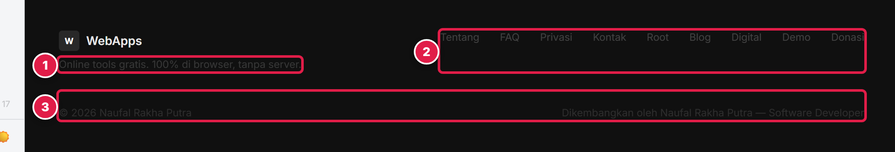
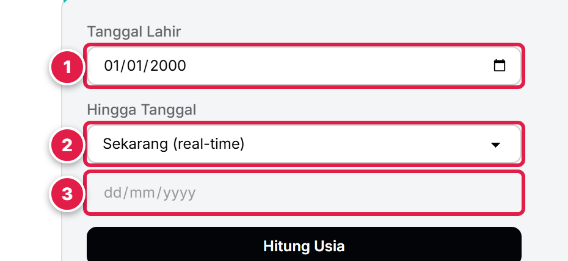
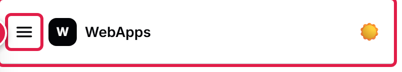
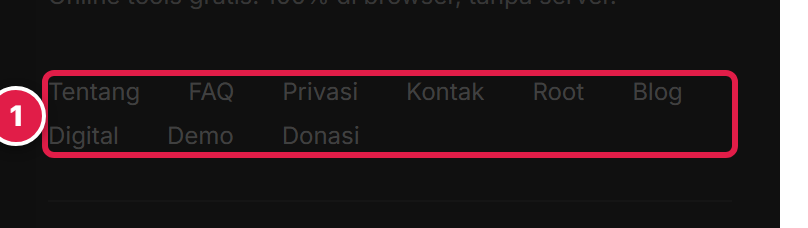
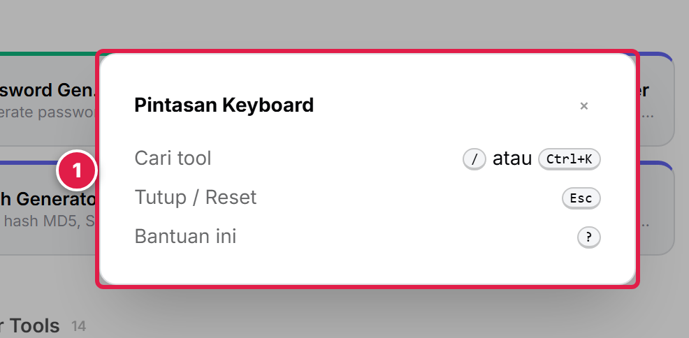

# Laporan Audit & Perbaikan Aksesibilitas Web

**Situs:** https://webapps.naufalrakha.my.id
**Tanggal:** 28 Oktober 2026
**Standar:** WCAG 2.2 Level AA
**Halaman diuji:** Beranda (`/`), Age Calculator (`/tools/age-calculator/`), Kontak (`/contact/`)

**Metode:** Lighthouse 13.6.0 (Accessibility), axe-core 4.14.0, dan uji manual keyboard, mode gelap, modal, serta reflow 320 px di Chrome 156.

---

## 1. Ringkasan

| Halaman | Skor Lighthouse | Pelanggaran axe-core |
|---------|-----------------|----------------------|
| Beranda | 65 / 100 | 134 node |
| Age Calculator | 67 / 100 | 46 node |
| Kontak | 61 / 100 | 25 node |

Situs **belum memenuhi WCAG 2.2 Level AA** saat audit awal. Lima temuan dengan dampak terbesar dijelaskan di bawah; data lengkap ada di `audit-data/`.

### Status perbaikan

Kelima temuan sudah diperbaiki di kode sumber dan diverifikasi pada build produksi lokal:

| No | Perbaikan | Verifikasi |
|----|-----------|------------|
| 1 | Kontras teks: footer, tool card, sidebar, hasil Age Calculator, label kecil | Semua lolos 4,5:1 (teks normal) dan 3:1 (teks besar) |
| 2 | Label form: `for`/`id` pada `#birthDate`, `#modeSelect`, `#customDate` | axe-core: 0 pelanggaran `label`/`select-name` |
| 3 | Tombol menu mobile: `aria-label`, `aria-expanded`, `aria-controls` | Lighthouse `button-name`: lolos |
| 4 | Target sentuh footer: tinggi minimum 24 px | Lighthouse `target-size`: lolos |
| 5 | Modal: `role="dialog"`, `aria-modal`, `aria-labelledby`, fokus awal, trap fokus, restore fokus | Fokus masuk ke tombol tutup; Tab terkurung; Esc menutup |

**Hasil setelah perbaikan (Lighthouse Accessibility, build produksi lokal):**

| Halaman | Sebelum | Sesudah |
|---------|---------|---------|
| Beranda | 65 | **100** |
| Age Calculator | 67 | **100** |
| Kontak | 61 | **100** |

axe-core (tag WCAG 2.0/2.1/2.2 A–AA): **0 pelanggaran** pada ketiga halaman. Screenshot di bawah adalah kondisi **sebelum** perbaikan.

---

## 2. Tabel 5 Temuan

| No | Isu | Pengguna terdampak | Bukti | Kriteria WCAG 2.2 | Rekomendasi |
|----|-----|--------------------|-------|-------------------|-------------|
| 1 | Kontras teks rendah | Low vision, lansia, pengguna di bawah cahaya matahari | Footer: deskripsi **1,62:1**, link **1,89:1**, copyright **1,4:1**. Deskripsi tool card **2,96:1**. Angka hasil Age Calculator **2,53–2,69:1**. Ambang: 4,5:1 (teks normal), 3:1 (≥ 24 px bold) | 1.4.3 Contrast (Minimum) — AA | Ganti `opacity-30/40/50` dengan warna solid yang lolos kontras; perbaiki palet footer dan angka hasil |
| 2 | Label form tidak terhubung ke kontrol | Screen reader, pengguna keyboard, pengguna kognitif | `<input id="birthDate">`, `<select id="modeSelect">`, `<input id="customDate">` tidak punya `label for`, `aria-label`, atau wrapping. Label "Tanggal Lahir" hanya teks visual | 1.3.1 Info and Relationships — A; 3.3.2 Labels or Instructions — A; 4.1.2 Name, Role, Value — A | Pasangkan `label for="id"` dengan `id` kontrol; pastikan label tetap terlihat |
| 3 | Tombol menu mobile tanpa nama aksesibel | Screen reader, pengguna voice control | `<button id="mobileToggle">` hanya berisi SVG tanpa `aria-label`/teks. Lighthouse: `button-name`, "Element does not have inner text that is visible to screen readers" | 4.1.2 Name, Role, Value — A | Tambahkan `aria-label="Buka menu navigasi"` + `aria-expanded` + `aria-controls` |
| 4 | Target sentuh footer < 24 × 24 px | Pengguna motorik, tremor, pengguna layar sentuh | Link footer tinggi **16 px**; jarak aman ke tetangga **20–21,4 px**; syarat minimum 24 px | 2.5.8 Target Size (Minimum) — AA (baru di WCAG 2.2) | Tambah padding/gap sehingga area klik ≥ 24 × 24 px dan jarak aman ≥ 24 px |
| 5 | Modal pintasan tanpa semantik dialog & manajemen fokus | Screen reader, pengguna keyboard | Setelah `?` ditekan: fokus tetap di `<body>`, `activeInside=false`; `#shortcutsHelp` tanpa `role="dialog"`, `aria-modal`, atau label; Tab bisa keluar ke belakang modal | 2.4.3 Focus Order — A; 4.1.2 Name, Role, Value — A | Gunakan `<dialog>` atau `role="dialog" aria-modal="true"` + label; pindahkan fokus ke modal, trap fokus, kembalikan fokus saat ditutup |

---

## 3. Screenshot Komponen

### 3.1 Kontras teks — footer (Temuan 1)

| Penanda | Komponen | Rasio terukur |
|---------|----------|---------------|
| 1 | Deskripsi footer | 1,62:1 |
| 2 | Link footer | 1,89:1 |
| 3 | Baris copyright | 1,4:1 |

### 3.2 Label form — Age Calculator (Temuan 2)

| Penanda | Kontrol | Nama aksesibel |
|---------|---------|----------------|
| 1 | `input#birthDate` | tidak ada |
| 2 | `select#modeSelect` | tidak ada |
| 3 | `input#customDate` | tidak ada |

Label terlihat ("Tanggal Lahir", "Hingga Tanggal"), tetapi tidak terhubung secara programatik.

### 3.3 Tombol menu mobile (Temuan 3)

Penanda 1: tombol hamburger hanya berisi ikon SVG; tidak ada teks atau `aria-label`.

### 3.4 Target sentuh footer (Temuan 4)

Penanda 1: seluruh link footer hanya setinggi 16 px dengan jarak aman 20–21,4 px dari target lain.

### 3.5 Modal pintasan keyboard (Temuan 5)

Penanda 1: modal tampil, tetapi tidak memiliki peran dialog dan fokus keyboard tetap berada di `body`.

---

## 4. Batasan

- Pengujian dengan screen reader nyata (NVDA, VoiceOver) belum dilakukan; temuan disimpulkan dari struktur DOM dan alat otomatis.
- Uji pengguna dengan disabilitas dan perangkat mobile fisik belum dilakukan.
- Lighthouse/axe-core hanya mendeteksi sebagian masalah; hasil bukan bukti kepatuhan penuh.

---

## 5. Lampiran

- `audit-data/lh-home.json`, `lh-age.json`, `lh-contact.json` — hasil Lighthouse sebelum perbaikan
- `audit-data/lh-fix-home.json`, `lh-fix-age.json`, `lh-fix-contact.json` — hasil Lighthouse sesudah perbaikan
- `audit-data/result.json` — hasil axe-core, urutan Tab, duplikasi ID, mode gelap, modal
- `audit-data/reflow.mjs` — skrip uji reflow 320 px
- `audit-data/screenshots/` — lima screenshot komponen

Referensi: W3C, *Web Content Accessibility Guidelines (WCAG) 2.2* (2024); W3C WAI, *How to Meet WCAG 2.2 Quick Reference*.
